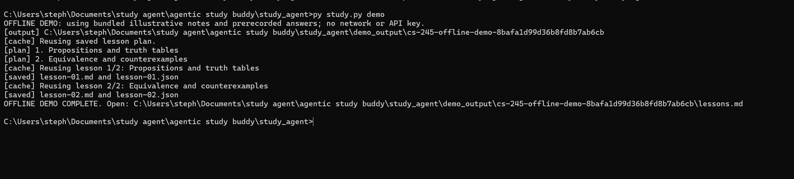

# Study Agent

**Turn lecture notes into structured lessons—and resume where you left off when generation is interrupted.**

Study Agent is a Python command-line application that organizes PDF, text, and Markdown lecture material into lessons with explanations, worked examples, and source-page references. It combines LLM generation with schema validation, persistent checkpoints, and bounded error recovery.

Built to support university study and explore how to make an AI workflow observable, testable, and recoverable.

**Stack:** Python · Pydantic · SQLite · LiteLLM · Groq · pypdf  
**Status:** Working CLI prototype; lesson accuracy and grouping remain under evaluation.

## See the result

* 
* [Example input: illustrative logic notes](examples/demo_lecture.md)
* [Example output: a complete lesson](examples/demo_lesson.md)
* Run the offline demo below to reproduce the file pipeline without an API key.

The offline demo uses prerecorded responses. It demonstrates source loading, validation, rendering, and persistence; it is not a live model-quality benchmark.

## What it does

* **Organizes lecture material:** creates lesson units and records reasons for excluded pages.
* **Produces usable study files:** saves objectives, definitions, explanations, worked examples, common mistakes, and recaps as Markdown and JSON.
* **Tracks source pages:** associates lesson content with identifiers derived from the supplied sources.
* **Recovers from interruptions:** saves completed lessons and reuses validated checkpoints on an unchanged rerun.
* **Handles model failures:** validates response structure, makes bounded correction attempts, and spaces requests to reduce rate-limit failures.
* **Links to assessment priorities:** optionally reads an existing SQLite assignments database and records lesson runs without changing stored priority scores.

## Engineering decisions

|Challenge|Approach|
|-|-|
|A model response can omit fields or contain malformed JSON|Supply a JSON schema, validate with Pydantic, and allow a bounded correction attempt.|
|A run can fail after producing useful work|Save per-lesson checkpoints and check their integrity before reuse.|
|Repeated calls can hit provider limits|Space requests, use provider retry timing when available, and cap request attempts.|
|Changing a source can make saved work stale|Include source content and relevant settings in the run identity.|
|Pipeline behavior needs repeatable tests|Substitute prerecorded responses and simulated failures while exercising real file and SQLite operations.|

Ordinary Python coordinates the workflow. The conceptual planner and lesson writer use the model through one shared client. See the [architecture and module map](docs/architecture.md).

## Quick start

From Windows CMD, with Git and Python installed:

```bat
git clone https://github.com/stephenzhao2007-oss/Study-Agent.git
cd Study-Agent
py -m pip install -r requirements.txt
py study.py demo
```

The demo prints the path to `lessons.md`. Open that file to read the output. Run the same command again to see completed work reused from cache.

### Generate from your own notes

Set `GROQ\_API\_KEY` in your environment, then run:

```bat
py study.py doctor
py study.py generate --course "CS 245" --source "lecture.pdf" --pages 1-5 --max-output-tokens 3000
```

Replace `lecture.pdf` with your own source file. `doctor` checks the local setup without making an API request. The default model configured in the code is `groq/openai/gpt-oss-20b`; `STUDY\_MODEL` can select another supported Groq model. Provider access and quotas depend on your account.

The current client waits 65 seconds between successful live requests. If a run stops, rerun the same command to resume completed work. See [terminal usage](docs/running.md) for extraction checks, page selection, and database options.

## Testing

```bat
py -m unittest discover -s tests -v
```

The suite contains **29 automated tests** covering source selection, output persistence, checkpoint recovery, database preservation, response validation, and retry behavior. Tests use simulated model responses and require no API calls or real retry delays.

The [test guide](docs/testing.md) maps every test to the behavior it checks. These tests verify software behavior; they do not establish that generated teaching is factually correct.

A live five-page trial produced three lessons and resumed after an interruption. Human review also found mathematical errors and damaged notation, informing the evaluation work below.

## Current limitations and next steps

* PDF text extraction can lose mathematical notation and does not interpret images or handwriting.
* Source-reference checks establish that a cited page was supplied, not that it supports the model's claim. Generated lessons need content review.
* Lesson grouping and excluded-page decisions need evaluation on representative lectures.
* Priority ingestion is currently a separate prototype. Lecture-to-assessment mapping remains manual.
* Active recall, answer assessment, review scheduling, and a user interface are planned features.

Near-term work focuses on lesson correctness checks, clearer grouping, and reproducible testing across operating systems. See the [backlog](docs/backlog.md).

## Development notes

* [Architecture](docs/architecture.md)
* [Test coverage and execution](docs/testing.md)
* [Debugging history](docs/debugging.md)
* [Windows SQLite cleanup investigation](docs/issues/windows-sqlite-cleanup.md)
* [Project scope](docs/project_scope.md)

Developed with AI assistance for implementation and debugging. The project records observed failures, fixes, and verification evidence; pre-Git development notes are retrospective.

