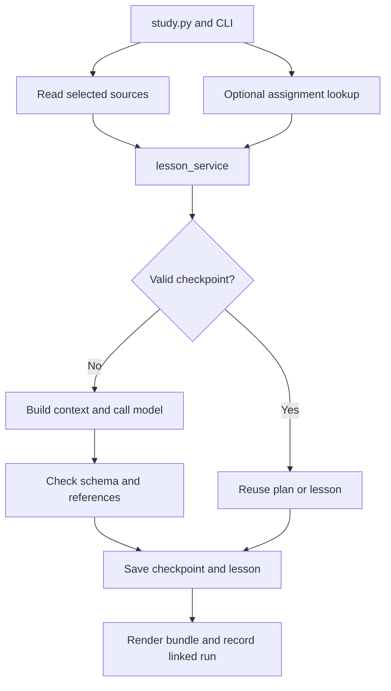

# Architecture and file responsibilities

## Original scripts versus the current package

| Earlier file/proposal | Original role | Current relationship |
|---|---|---|
| `1_triage_node.py` / `python_triage_node.py` (names used during prototyping; verify the actual local filename) | Extraction, schema, scoring, SQLite insert in one script | Remains a separate priority prototype. `database.py` reads its assignments schema; the lesson package does not replace its scoring logic |
| `2_curriculum_node.py` / `curriculum.py` | Fetch pending assignments, generate broad summaries/MCQs, print them, set `lessons_generated` | Responsibilities now split among database access, source/context construction, generation, rendering, and persistence; active recall is deferred to its own future feature |
| Initial `lesson_types.py` | Define Pydantic content contracts | Expanded into source, planning, lesson, validation, and bundle contracts |
| Initial `lesson_generator.py` | One model call | Now focused on one lesson; provider access/retries moved to `llm_client.py`, prompts to `prompts.py` |
| Initial `lesson_validator.py` | String matching, broad bracket rejection | Now checks supplied source IDs, page accounting, structure, and narrow placeholders; it does not verify mathematical truth |
| Initial `lesson_service.py` | Demonstration orchestration | Now coordinates the full run, caches, files, and optional DB ledger |
| Initially listed `source_loader.py`, `lesson_segmenter.py`, `lesson_context_builder.py` | Proposed responsibilities without implementations in the supplied snippet | Implemented and called in the current package |

There is one executable entry point for this package. Do not run each module manually. Python imports these files as needed. More source files do not by themselves cause more API calls or token usage.

## Exact current file map

All module paths below are relative to `curriculum_engine/` unless otherwise stated.

| File | What it does | Why it exists separately |
|---|---|---|
| Root `study.py` | Starts the CLI and handles missing dependencies | One unmistakable command to run; avoids silent execution of a definitions-only file |
| `__init__.py` | Package identity/version | Supports imports and includes implementation version in run identity |
| `cli.py` | Parses `doctor`, `tasks`, `inspect`, `demo`, `generate`; shows progress/errors | Terminal interaction can later be complemented by a UI without putting UI concerns inside generation |
| `config.py` | Default model, prompt/output limits, timeout, retry and lesson caps | Keeps runtime settings visible and centralized; current 65-second pacing itself resides in the patched client |
| `lesson_types.py` | Pydantic models for sources, plan units, content, examples, validation, bundle | Provides a consistent contract for generation, saving, and future consumers |
| `source_loader.py` | Reads PDF/TXT/MD, selects pages, computes hashes/source IDs, surfaces extraction problems | Isolates document handling so OCR or another extractor can later be added here |
| `lesson_segmenter.py` | Requests a conceptual plan and checks source-page accounting | Separates deciding lesson boundaries from writing the lessons |
| `lesson_context_builder.py` | Assembles all selected pages for planning, then the exact cited pages for each lesson | Makes the information supplied to each model call explicit and testable |
| `prompts.py` | Planning/teaching instructions and prompt version | Enables deliberate changes to teaching behaviour and invalidation of stale cached output |
| `llm_client.py` | LiteLLM request, complete JSON schema instructions, response parsing, repair, rate handling, request cap, error-detail filtering | One place to maintain provider behaviour and inject fake responses for tests |
| `lesson_generator.py` | Generates and validates one lesson, assigns its metadata | Keeps the teaching task distinct from whole-run coordination |
| `lesson_validator.py` | Checks reference membership, page accounting, some placeholders; adds review notes | Defines what the software actually checks and what remains unverified |
| `lesson_renderer.py` | Turns every structured section into readable Markdown with references | Presentation changes need not change generation or data contracts |
| `storage.py` | Atomic writes and hashed checkpoint envelopes | Reduces incomplete-file risk and permits reuse/recovery; this is not cryptographic protection against a malicious editor |
| `database.py` | Reads existing assignments and records completed linked runs | Keeps SQL and compatibility with the original schema out of prompts and generation logic |
| `lesson_service.py` | Orchestrates plan/cache/generate/render/save/record | Gives CLI and a future API a reusable service boundary |
| `demo.py` | Supplies deterministic prerecorded responses to the real local pipeline | Demonstrates operation without a key and supports repeatable offline tests |
| Root `requirements.txt` | Declares Pydantic, LiteLLM, and pypdf dependencies | Makes installation repeatable, though version ranges are not a fully locked environment |
| `examples/demo_lecture.md` | Synthetic lecture input | A shareable sample independent of private university slides |
| `examples/demo_responses.json` | Prerecorded plan/content | Makes the offline demo deterministic; it is explicitly labeled, not represented as live inference |
| `tests/test_pipeline.py` | Original 23 regression tests | Covers pipeline, persistence, failure handling, input handling, and client parsing |
| `tests/test_rate_limits.py` | Six retained checks added in the documentation kit | Makes the later client-patch verification reproducible in the normal test command |

## Execution order

1. `study.py` invokes `cli.main()`.
2. CLI loads the selected sources with `source_loader` and, for `--assignment-id`, reads the assignment with `database`.
3. `lesson_service` calculates a run identity using course, topic, model/settings, source hashes/pages/text, and version information.
4. It loads an existing valid plan checkpoint, or calls `lesson_segmenter` with `lesson_context_builder` output through `llm_client`.
5. For each unit, it reuses a valid lesson checkpoint or calls `lesson_generator`, which builds source context and invokes the client.
6. Pydantic and reference checks reject structurally invalid results. The client allows one bounded corrected generation for response-format failures.
7. Each accepted lesson is checkpointed, saved as JSON, and rendered to Markdown before proceeding to the next.
8. The combined bundle and final manifest are written. A linked assignment run is recorded in SQLite; a standalone course run only writes files.

Supporting files such as schemas, prompts, settings, and validators are dependencies, not extra sequential model calls.

## Model calls and token usage

Planning usually needs one successful request over the selected material. Generation usually needs one successful request per lesson using that lesson's chosen pages. A three-lesson run therefore normally has four successful calls before any retries, unless checkpoints are reused. Format repairs and failed network/provider attempts add requests. The request count starts over per invocation.

Caching reduces repeated generation. Spacing reduces request frequency, not total tokens. The character cap is not an accurate token estimator or cost budget. The entire selected text still enters the planning call; there is no embedding index, vector database, token-aware batching, or persistent topic-map retrieval yet. Context selection here is explicit page selection, not a completed RAG system.

The client currently uses JSON-object mode plus a full schema in its instructions, followed by local Pydantic validation. It does not currently send a strict provider-side `json_schema` response format.

## Database and generated files

`assignments` belongs to the earlier priority workflow. It stores assessment metadata, scores, manual-review state, and a legacy completion flag. `lesson_runs` is added when a successful linked generation is recorded. It stores a run ID, assignment/course, topic, status, output path, timestamp, and lesson count; the full lessons remain in files.

The old `lessons_generated=1` flag is neither trusted as proof of a good lesson nor reset by this package. A previous generic terminal summary could have set it. One lecture run also does not prove that a whole exam's scope has been covered.

| Output | Purpose |
|---|---|
| `plan.json` | Overview, teaching units, prerequisites, source IDs, exclusions |
| `sources.json` | Extracted source snapshots and warnings; potentially private course content |
| `lesson-01.json` / `.md` | Structured and readable individual lesson |
| `lessons.json` / `.md` | Combined collection for future software consumption and current reading |
| `manifest.json` | Request identity, run status, and completed-output paths |
| `checkpoints/` | Hashed plan/lesson payloads for recovery |

The filesystem and SQLite writes are not one cross-system transaction. If recording the DB run fails after files save, the command fails visibly and can be rerun. Concurrent-worker coordination has not been implemented or load-tested.

## Where the architecture can grow

Add assessment/material mapping, question generation, attempts/feedback, review scheduling, and API/UI services when their inputs/outputs are defined. Keep naming these as proposed modules until they exist. The current file split is a maintainability choice, not proof of educational quality or the only correct architecture; very thin wrappers can be combined later if that makes the code easier to maintain.
